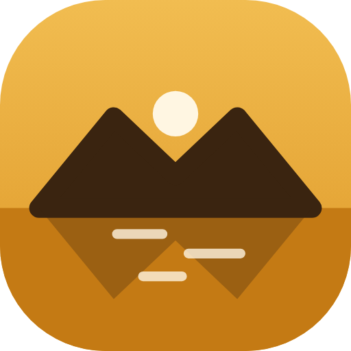
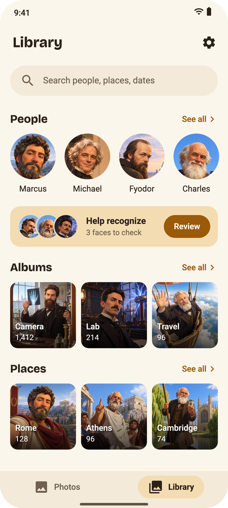
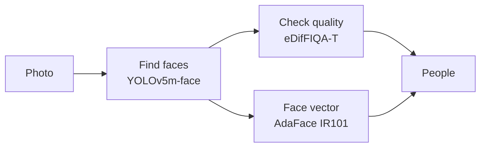

<div align="center">



# Memoria Photo

**The gallery that knows your people, and tells no one.**

Android photo gallery with face recognition that runs fully on your phone.<br>
No cloud. No account. No trackers.

[](https://github.com/HomerKLP/Memoria-Photo/releases)
[](LICENSE)


[Download](#install) · [Features](#features) · [Privacy](#privacy) · [Build](#build-from-source)



</div>

## Why Memoria

| | |
|---|---|
| 🧠 **Knows your people** | Finds every face and groups it into people, on its own. |
| 🔒 **Private by design** | Photos and faces never leave the phone. |
| ⚡ **Fast on the NPU** | Runs on the phone's AI chip, then GPU, then CPU. |
| 💛 **Free and open** | GPL-3.0. No ads, no account, no paid tier. |

## Face recognition

> ### 3,000+ faces. 0 in the wrong person.
> Tested on a real phone library: every face the app put into a person was the right one.

- **People, found for you.** Memoria scans your photos in the background and groups faces into people.
- **Strict on purpose.** A person starts only from sharp camera faces seen in 6+ photos, so screenshots and memes never add strangers. Unsure faces wait for you instead of a guess.
- **Help recognize.** The app asks only about faces it is unsure of: Yes, No or Not a face. One answer settles look-alikes too.
- **Name, merge, hide.** Name someone once and every photo follows. Your names and fixes stay when new photos come in.
- **Search by name.** Type a name, see every photo of them.

### How it works



The models were picked on real family photos, not only on paper: 3 face finders and 3 recognizers compared side by side. Details in [docs/face-pipeline.md](docs/face-pipeline.md).

## Features

- **Photos:** timeline by day and month, month slider, select many with a drag.
- **Viewer:** zoom, swipe, details (date, time zone, place, camera, people).
- **Albums:** phone folders, new albums, move photos.
- **Places:** photos by town, names found offline.
- **Favorites, Videos, Trash:** use the phone's own favorites and trash.
- **Search:** people, places, months.
- **Folders to skip:** keep some folders out of face search.

## Privacy

- All AI runs on the phone. No photo is ever uploaded or analyzed elsewhere.
- No account, no ads, no analytics, no trackers.
- Faces and names stay in a local database. Android's cloud backup is off, so it never reaches your Google account.
- The app never copies your library. It works on the phone's own photos.
- The internet is used once: to download the face models from this repo's releases.

## Speed

| | NPU | GPU | CPU |
|---|---|---|---|
| Face recognition, per photo | ~70 ms | ~85 ms | ~520 ms |
| Whole photo, opening it included | ~130 ms | ~145 ms | ~580 ms |

A library of 10,000 photos takes about **22 minutes** on the NPU, or about **24 minutes** on the GPU.

<sub>Measured on a Snapdragon 8 Elite. Your phone may be faster or slower, depending on its chip.</sub>

The NPU is used on Snapdragon 8 Gen 1 to 8 Elite Gen 5. Other phones use the GPU, then the CPU.

## Install

1. Download `memoria-<version>.apk` from [Releases](https://github.com/HomerKLP/Memoria-Photo/releases) and open it on your phone.
2. Open the app on Wi-Fi. It downloads the face models by itself (about 170 MB, once). On mobile data, tap **Download** in **Settings › Finding faces › Face models**.
3. Done. Face search starts on its own when the models are ready.

To check the APK is ours, its signing certificate SHA-256 must be:

```
bc1c500550d9e3bd73e27f44132877189329f88875ace0bd6049a828e792b240
```

`apksigner verify --print-certs memoria-<version>.apk` prints it.

## Roadmap

- **Smart search:** type "documents", "receipts" or "beach at sunset".
- **Photo types:** browse selfies, group photos and screenshots.
- **Pets:** your cats and dogs, found and grouped like people.
- **Video compression** with no visible loss.
- **Google Takeout import:** bring your old Google Photos home.
- **Dark theme.**

Full plan in [ROADMAP.md](ROADMAP.md).

## Build from source

You need [Android Studio](https://developer.android.com/studio) (for its JDK and the Android SDK) and a phone with Android 13+ and USB debugging on.

```sh
git clone https://github.com/HomerKLP/Memoria-Photo.git
cd Memoria-Photo
make install                   # macOS: build, install over USB, open the app
./gradlew :app:assembleDebug   # anywhere else, with JAVA_HOME set
```

The debug build installs as "Memoria Debug", next to the release app. `make` alone lists every command.

The face models are made from the original ONNX files by [`bench/tflite.py`](bench/tflite.py) (needs [uv](https://docs.astral.sh/uv/)).

## Tech

Kotlin · Jetpack Compose · Material 3 · Room · WorkManager · [LiteRT](https://github.com/google-ai-edge/LiteRT) (NPU, GPU, CPU) · Python bench for picking and converting models

## Credits

Memoria stands on great open work:

- [YOLOv5-face](https://github.com/deepcam-cn/yolov5-face) finds faces (GPL-3.0).
- [AdaFace](https://github.com/mk-minchul/AdaFace) tells people apart (MIT).
- [eDifFIQA](https://github.com/LSIbabnikz/DifFIQA) scores face quality (MIT).
- [GeoNames](https://www.geonames.org) gives offline town names (CC BY 4.0).
- [Bricolage Grotesque](https://github.com/ateliertriay/bricolage) and [Roboto](https://github.com/googlefonts/roboto-classic) fonts (SIL OFL 1.1).

Full list in [THIRD_PARTY.md](THIRD_PARTY.md). The photos in the screenshot are AI-generated.

## License

[GPL-3.0](LICENSE), with one extra permission so the APK can ship Qualcomm's closed NPU libraries:

> **Additional permission under GNU GPL version 3 section 7**
>
> If you modify this Program, or any covered work, by linking or combining it with the Qualcomm QNN runtime libraries (`com.qualcomm.qti:qnn-runtime`, or a modified version of those libraries), containing parts covered by the terms of the [Qualcomm AI Stack License](https://softwarecenter.qualcomm.com/api/download/software/licenses/ai_model_hub/v1/LICENSE.pdf), the licensors of this Program grant you additional permission to convey the resulting work.
